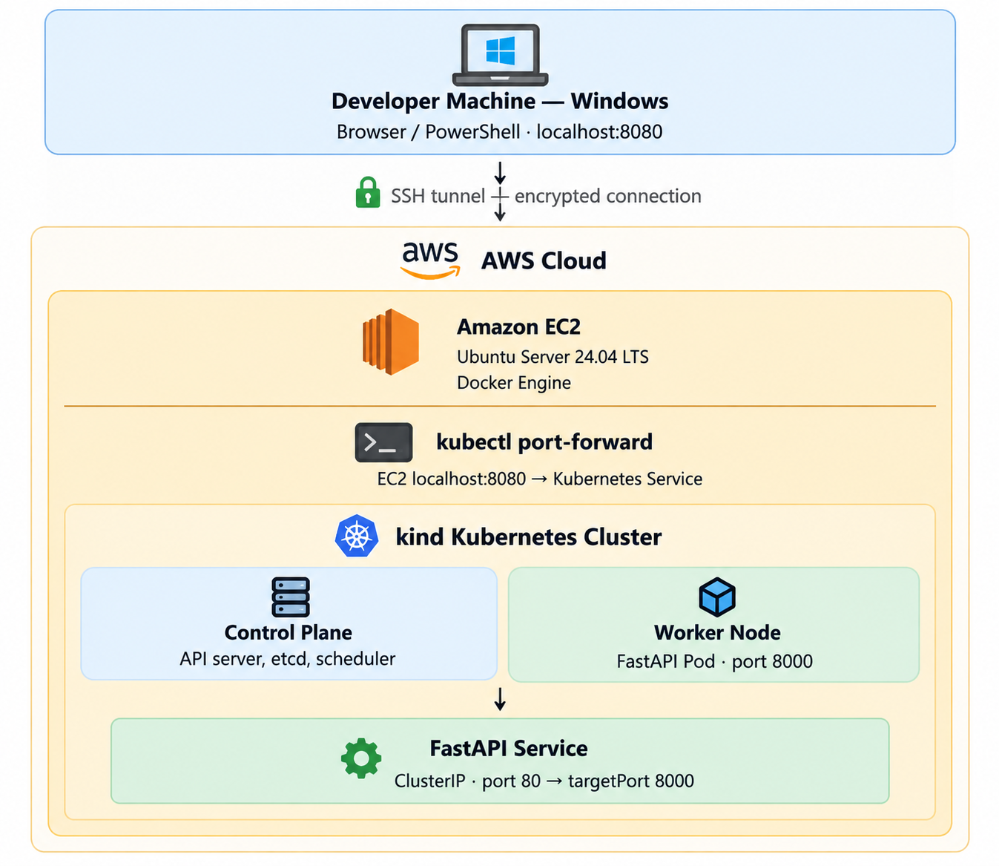

# 🚀 FastAPI on Kubernetes — Kind Lab (AWS EC2)

> **Complete end-to-end guide** to deploy a containerized FastAPI application on an AWS EC2 instance using a local **kind** (Kubernetes in Docker) cluster.

[](https://python.org)
[](https://fastapi.tiangolo.com)
[](https://docs.docker.com)
[](https://kind.sigs.k8s.io)
[](https://aws.amazon.com/ec2)

---

## 📋 Table of Contents

1. [Project Overview](#1-project-overview)
2. [Architecture](#2-architecture)
3. [Project Structure](#3-project-structure)
4. [Prerequisites & Tool Installation](#4-prerequisites--tool-installation)
   - [4.1 AWS EC2 Instance Setup](#41-aws-ec2-instance-setup)
   - [4.2 Connect to EC2 from Windows](#42-connect-to-ec2-from-windows)
   - [4.3 Update Ubuntu System](#43-update-ubuntu-system)
   - [4.4 Install Docker Engine](#44-install-docker-engine)
   - [4.5 Install kubectl](#45-install-kubectl)
   - [4.6 Install kind](#46-install-kind)
   - [4.7 Verify All Installations](#47-verify-all-installations)
5. [Application Setup](#5-application-setup)
6. [Create kind Cluster](#6-create-kind-cluster)
7. [Build & Load Docker Image](#7-build--load-docker-image)
8. [Deploy to Kubernetes](#8-deploy-to-kubernetes)
9. [Verify Deployment](#9-verify-deployment)
10. [Test the Application](#10-test-the-application)
11. [Access from Windows Browser](#11-access-from-windows-browser)
12. [Health Probes](#12-health-probes)
13. [Scaling & Self-Healing](#13-scaling--self-healing)
14. [HPA — Horizontal Pod Autoscaler](#14-hpa--horizontal-pod-autoscaler)
15. [Push Image to Amazon ECR](#15-push-image-to-amazon-ecr)
16. [Troubleshooting](#16-troubleshooting)
17. [Cleanup](#17-cleanup)
18. [API Reference](#18-api-reference)

---

## 1. Project Overview

This lab teaches you to:
- Launch and configure an **AWS EC2** instance (Ubuntu 24.04 LTS)
- Install **Docker**, **kubectl**, and **kind** from official sources
- Write and containerize a **FastAPI** application with production-grade settings
- Create a **local Kubernetes cluster** using kind on EC2
- Deploy using **Kubernetes manifests** (Deployment, Service, HPA)
- Configure **Startup, Liveness, and Readiness probes**
- Scale from 1 → 3 → 5 replicas and observe **self-healing**
- Access the app securely from Windows via **SSH tunnel + port-forward**
- Push the image to **Amazon ECR** and prepare for **EKS migration**

---

## 2. Architecture



```
┌──────────────────────────────────────────────────────────────────────┐
│  Your Windows Machine                                                 │
│  PowerShell / Browser → localhost:8080                               │
└───────────────────────────┬──────────────────────────────────────────┘
                            │  SSH Tunnel (-L 8080:127.0.0.1:8080)
                            ▼
┌──────────────────────────────────────────────────────────────────────┐
│  AWS EC2 Instance  (Ubuntu 24.04 LTS)  t3.medium / t3.large          │
│  Public IP: 54.x.x.x   Private IP: 172.31.x.x                       │
│                                                                       │
│  kubectl port-forward → localhost:8080                                │
│                                                                       │
│  ┌───────────────────────────────────────────────────────────────┐   │
│  │  Docker Engine (running on EC2 host)                          │   │
│  │                                                               │   │
│  │   ┌─────────────────────┐    ┌────────────────────────────┐  │   │
│  │   │  kind-control-plane │    │  kind-worker               │  │   │
│  │   │  (Docker Container) │    │  (Docker Container)        │  │   │
│  │   │                     │    │  ┌──────────────────────┐  │  │   │
│  │   │  ● etcd             │    │  │  Pod: fastapi-app    │  │  │   │
│  │   │  ● kube-apiserver   │    │  │  IP: 10.244.x.x      │  │  │   │
│  │   │  ● scheduler        │    │  │  Port: 8000          │  │  │   │
│  │   │  ● controller-mgr   │    │  └──────────────────────┘  │  │   │
│  │   └─────────────────────┘    └────────────────────────────┘  │   │
│  │                                                               │   │
│  │   Service: fastapi-service  ClusterIP 10.96.x.x:80           │   │
│  └───────────────────────────────────────────────────────────────┘   │
└──────────────────────────────────────────────────────────────────────┘
```

**Abstraction Layers:**

| Layer | What it is | IP / Address |
|---|---|---|
| EC2 Instance | Physical/virtual machine on AWS | Public: `54.x.x.x`, Private: `172.31.x.x` |
| Docker Container (kind node) | Container acting as a K8s Node | `172.18.x.x` (Docker bridge) |
| Kubernetes Pod | Smallest deployable unit (runs your app) | `10.244.x.x` (Pod CIDR) |
| Kubernetes Service | Virtual load balancer (stable DNS + IP) | `10.96.x.x` (Service CIDR) |

---

## 3. Project Structure

```
fastapi-kind-lab/
│
├── app/
│   └── main.py              # FastAPI app — 4 endpoints + Kubernetes Downward API
│
├── k8s/
│   ├── namespace.yaml       # Kubernetes Namespace: fastapi-lab
│   ├── deployment.yaml      # Deployment — probes, security context, resource limits
│   ├── service.yaml         # ClusterIP Service (port 80 → Pod port 8000)
│   └── hpa.yaml             # Horizontal Pod Autoscaler (CPU+memory, 1–10 replicas)
│
├── Dockerfile               # Multi-stage build — non-root user, read-only filesystem
├── .dockerignore            # Excludes venvs, __pycache__, IDE files from build context
├── kind-config.yaml         # kind cluster: 1 control-plane + 1 worker node
├── requirements.txt         # fastapi==0.115.0 | uvicorn[standard]==0.31.0 | pydantic==2.9.2
└── README.md                # This file
```

---

## 4. Prerequisites & Tool Installation

### 4.1 AWS EC2 Instance Setup

#### Recommended Instance Specifications

| Setting | Value |
|---|---|
| **AMI** | Ubuntu Server 24.04 LTS (HVM), SSD Volume Type |
| **Instance Type** | `t3.medium` (2 vCPU, 4 GB RAM) minimum · `t3.large` (2 vCPU, 8 GB) recommended |
| **Storage** | 30 GB gp3 EBS |
| **Key Pair** | RSA 4096-bit `.pem` |
| **Security Group** | SSH TCP/22 from `YOUR_IP/32` only |

> ⚠️ **Why t3.medium at minimum?**  
> kind creates full Kubernetes nodes as Docker containers. Each node requires ~1 GB RAM for kubelet + etcd. With `t3.small` (2 GB total), the system will OOM-kill Pods. Always use `t3.medium` or larger.

#### Launch via AWS Console

1. Go to **EC2 → Launch Instance**
2. **Name**: `fastapi-kind-lab`
3. **AMI**: Search `Ubuntu 24.04 LTS` → Select (64-bit x86)
4. **Instance type**: `t3.medium` or `t3.large`
5. **Key pair** → Create new key pair:
   - Name: `fastapi-lab-key`
   - Type: `RSA` · Format: `.pem`
   - Download and save securely
6. **Security Group** → Edit:
   - Add rule: `SSH` · TCP · Port `22` · Source: `MY IP`
7. **Storage**: `30 GB` · `gp3`
8. Click **Launch Instance**

#### Security Group Rules (Least Privilege)

| Direction | Type | Protocol | Port | Source | Purpose |
|---|---|---|---|---|---|
| Inbound | SSH | TCP | 22 | `YOUR_IP/32` | Secure SSH only |
| Outbound | All traffic | All | All | `0.0.0.0/0` | Internet access for installs |

> 💡 Find your IP on Windows PowerShell:
> ```powershell
> Invoke-RestMethod -Uri "https://ifconfig.me"
> ```

---

### 4.2 Connect to EC2 from Windows

```powershell
# Step 1 — Fix .pem key permissions (required by SSH)
$keyPath = "C:\Users\YourName\Downloads\fastapi-lab-key.pem"
icacls $keyPath /inheritance:r
icacls $keyPath /grant:r "$env:USERNAME:(R)"

# Step 2 — Connect
$EC2_IP = "YOUR_EC2_PUBLIC_IP"
ssh -i $keyPath ubuntu@$EC2_IP
```

**Optional — Add SSH config for convenience** (`C:\Users\YourName\.ssh\config`):

```ssh-config
Host fastapi-lab
    HostName YOUR_EC2_PUBLIC_IP
    User ubuntu
    IdentityFile C:\Users\YourName\Downloads\fastapi-lab-key.pem
    ServerAliveInterval 60
```

Then simply:
```powershell
ssh fastapi-lab
```

---

### 4.3 Update Ubuntu System

> Run all commands below inside your **EC2 SSH session**

```bash
# Update package index
sudo apt-get update -y

# Upgrade all installed packages
sudo apt-get upgrade -y

# Install essential tools
sudo apt-get install -y \
    curl \
    wget \
    git \
    unzip \
    gnupg \
    lsb-release \
    ca-certificates \
    apt-transport-https \
    software-properties-common \
    htop \
    jq \
    tree \
    net-tools

# Verify system info
uname -a          # Kernel version
lsb_release -a    # Ubuntu version
free -h           # Available RAM
df -h /           # Disk space
nproc             # CPU core count
```

**Expected output of `free -h` on t3.medium:**
```
              total        used        free      shared  buff/cache   available
Mem:          3.7Gi       300Mi       3.1Gi        1Mi       350Mi       3.2Gi
```

---

### 4.4 Install Docker Engine

```bash
# Step 1 — Remove old/conflicting Docker packages
sudo apt-get remove -y \
    docker docker-engine docker.io containerd runc 2>/dev/null || true

# Step 2 — Add Docker's official GPG key
sudo install -m 0755 -d /etc/apt/keyrings

curl -fsSL https://download.docker.com/linux/ubuntu/gpg | \
    sudo gpg --dearmor -o /etc/apt/keyrings/docker.gpg

sudo chmod a+r /etc/apt/keyrings/docker.gpg

# Step 3 — Add Docker apt repository
echo \
  "deb [arch=$(dpkg --print-architecture) signed-by=/etc/apt/keyrings/docker.gpg] \
  https://download.docker.com/linux/ubuntu \
  $(. /etc/os-release && echo "$VERSION_CODENAME") stable" | \
  sudo tee /etc/apt/sources.list.d/docker.list > /dev/null

# Step 4 — Install Docker Engine
sudo apt-get update -y

sudo apt-get install -y \
    docker-ce \
    docker-ce-cli \
    containerd.io \
    docker-buildx-plugin \
    docker-compose-plugin

# Step 5 — Start and enable Docker on boot
sudo systemctl start docker
sudo systemctl enable docker

# Step 6 — Add ubuntu user to docker group (avoid sudo every time)
sudo usermod -aG docker $USER

# Step 7 — Apply group change in current session
newgrp docker

# Step 8 — Verify
docker version
docker run hello-world
```

**Expected output:**
```
Client: Docker Engine - Community
 Version:           27.x.x
 ...
Server: Docker Engine - Community
 Engine:
  Version: 27.x.x
```

> 💡 **When does a new session matter?**  
> `newgrp docker` applies the group in the **current terminal only**. If you open a new SSH session, it works automatically because `/etc/group` is read at login.

---

### 4.5 Install kubectl

```bash
# Step 1 — Get latest stable version
KUBECTL_VERSION=$(curl -L -s https://dl.k8s.io/release/stable.txt)
echo "Installing kubectl $KUBECTL_VERSION"

# Step 2 — Download the binary
curl -LO "https://dl.k8s.io/release/${KUBECTL_VERSION}/bin/linux/amd64/kubectl"

# Step 3 — Download checksum file
curl -LO "https://dl.k8s.io/release/${KUBECTL_VERSION}/bin/linux/amd64/kubectl.sha256"

# Step 4 — Verify checksum (must print "kubectl: OK")
echo "$(cat kubectl.sha256)  kubectl" | sha256sum --check

# Step 5 — Install to system path
sudo install -o root -g root -m 0755 kubectl /usr/local/bin/kubectl

# Step 6 — Clean up
rm -f kubectl kubectl.sha256

# Step 7 — Verify
kubectl version --client
```

**Expected output:**
```
Client Version: v1.32.x
Kustomize Version: v5.x.x
```

---

### 4.6 Install kind

```bash
# Step 1 — Get latest kind version from GitHub API
KIND_VERSION=$(curl -s https://api.github.com/repos/kubernetes-sigs/kind/releases/latest \
    | grep '"tag_name":' \
    | sed -E 's/.*"([^"]+)".*/\1/')

echo "Installing kind $KIND_VERSION"

# Step 2 — Download kind binary
curl -Lo ./kind \
    "https://github.com/kubernetes-sigs/kind/releases/download/${KIND_VERSION}/kind-linux-amd64"

# Step 3 — Make executable and move to PATH
chmod +x ./kind
sudo mv ./kind /usr/local/bin/kind

# Step 4 — Verify
kind version
```

**Expected output:**
```
kind v0.24.0 go1.22.4 linux/amd64
```

---

### 4.7 Verify All Installations

```bash
echo "=============================="
echo "  Tool Verification Summary"
echo "=============================="

echo ""
echo "--- Docker ---"
docker --version
docker info | grep -E "Server Version|Containers|Images|Operating System"

echo ""
echo "--- kubectl ---"
kubectl version --client --short 2>/dev/null || kubectl version --client

echo ""
echo "--- kind ---"
kind version

echo ""
echo "--- System Resources ---"
echo "CPU cores : $(nproc)"
echo "RAM       : $(free -h | awk '/^Mem:/{print $2}') total / $(free -h | awk '/^Mem:/{print $7}') available"
echo "Disk      : $(df -h / | awk 'NR==2{print $4}') free on /"

echo ""
echo "=============================="
echo "  All tools verified!"
echo "=============================="
```

---

## 5. Application Setup

### Step 1 — Copy project to EC2 (from Windows PowerShell)

```powershell
$keyPath = "C:\Users\YourName\Downloads\fastapi-lab-key.pem"
$EC2_IP  = "YOUR_EC2_PUBLIC_IP"

# Copy the entire project folder to EC2
scp -i $keyPath -r D:\EKS2\fastapi-kind-lab ubuntu@${EC2_IP}:~/
```

### Step 2 — Verify files on EC2

```bash
# SSH into EC2 first, then:
cd ~/fastapi-kind-lab
tree .
```

**Expected structure:**
```
.
├── Dockerfile
├── .dockerignore
├── kind-config.yaml
├── README.md
├── requirements.txt
├── app
│   └── main.py
└── k8s
    ├── deployment.yaml
    ├── hpa.yaml
    ├── namespace.yaml
    └── service.yaml
```

### Step 3 — (Optional) Test app locally before containerizing

```bash
cd ~/fastapi-kind-lab

# Create virtual environment
python3 -m venv .venv
source .venv/bin/activate

# Install dependencies
pip install -r requirements.txt

# Run FastAPI locally
uvicorn app.main:app --host 0.0.0.0 --port 8000 &
sleep 2

# Test endpoints
curl -s http://localhost:8000/ | jq .
curl -s http://localhost:8000/health/live | jq .
curl -s http://localhost:8000/health/ready | jq .
curl -s http://localhost:8000/info | jq .

# Stop server
kill %1
deactivate
rm -rf .venv
```

---

## 6. Create kind Cluster

### Step 1 — Create the cluster

```bash
cd ~/fastapi-kind-lab

kind create cluster \
    --name fastapi-lab \
    --config kind-config.yaml \
    --wait 120s
```

**Expected output:**
```
Creating cluster "fastapi-lab" ...
 ✓ Ensuring node image (kindest/node:v1.32.x) 🖼
 ✓ Preparing nodes 📦 📦
 ✓ Writing configuration 📜
 ✓ Starting control-plane 🕹️
 ✓ Installing CNI 🔌
 ✓ Installing StorageClass 💾
 ✓ Joining worker nodes 🚜
Set kubectl context to "kind-fastapi-lab"
```

> 💡 First run downloads ~700 MB `kindest/node` image — takes 2–5 minutes.  
> Subsequent runs use cached image and take ~30 seconds.

### Step 2 — Verify cluster context

```bash
# Check current context
kubectl config current-context
# Expected: kind-fastapi-lab

# List all available contexts
kubectl config get-contexts

# Cluster info
kubectl cluster-info --context kind-fastapi-lab
```

### Step 3 — Verify nodes

```bash
kubectl get nodes -o wide
```

**Expected output:**
```
NAME                         STATUS   ROLES           AGE   VERSION
fastapi-lab-control-plane    Ready    control-plane   60s   v1.32.x
fastapi-lab-worker           Ready    <none>          45s   v1.32.x
```

### Step 4 — Verify kind Docker containers

```bash
docker ps
```

**Expected output:**
```
CONTAINER ID   IMAGE                  STATUS    NAMES
a1b2c3d4e5f6   kindest/node:v1.32.x   Up 2 min  fastapi-lab-worker
f6e5d4c3b2a1   kindest/node:v1.32.x   Up 2 min  fastapi-lab-control-plane
```

> 💡 Each kind node is actually a **Docker container** running inside your EC2 instance!

---

## 7. Build & Load Docker Image

### Step 1 — Build the Docker image

```bash
cd ~/fastapi-kind-lab

docker build \
    --tag fastapi-kind-lab:1.0.0 \
    --tag fastapi-kind-lab:latest \
    --file Dockerfile \
    .
```

**Expected output:**
```
[+] Building 45.3s (14/14) FINISHED
 => [runtime 7/7] RUN chown -R appuser:appgroup /app
 => exporting to image
 => => naming to docker.io/library/fastapi-kind-lab:1.0.0
```

### Step 2 — Verify the image

```bash
docker images fastapi-kind-lab
```

**Expected output:**
```
REPOSITORY          TAG       IMAGE ID       CREATED          SIZE
fastapi-kind-lab    1.0.0     a1b2c3d4e5f6   10 seconds ago   145MB
fastapi-kind-lab    latest    a1b2c3d4e5f6   10 seconds ago   145MB
```

### Step 3 — Quick local smoke test

```bash
# Run container on EC2 to verify it works
docker run --rm -d --name fastapi-smoke -p 18080:8000 fastapi-kind-lab:1.0.0
sleep 3

curl -s http://localhost:18080/health/live | jq .
# Expected: { "status": "alive", ... }

docker stop fastapi-smoke
```

### Step 4 — Load image into kind cluster

```bash
kind load docker-image fastapi-kind-lab:1.0.0 --name fastapi-lab
```

**Expected output:**
```
Image: "fastapi-kind-lab:1.0.0" with ID "sha256:..." not yet present on node "fastapi-lab-worker", loading...
Image: "fastapi-kind-lab:1.0.0" with ID "sha256:..." not yet present on node "fastapi-lab-control-plane", loading...
```

> ⚠️ **Why `kind load` is required:**  
> kind nodes run their **own containerd runtime** inside Docker containers.  
> Kubernetes pulls images from the **node's containerd cache** — NOT your EC2 Docker daemon.  
> `kind load docker-image` copies the image from EC2 Docker → each kind node's containerd.

### Step 5 — Verify image inside kind node

```bash
docker exec fastapi-lab-worker crictl images | grep fastapi
```

**Expected output:**
```
docker.io/library/fastapi-kind-lab   1.0.0   sha256:abc...   145MB
```

---

## 8. Deploy to Kubernetes

Apply all manifests in this exact order:

```bash
cd ~/fastapi-kind-lab

# 1. Create the Namespace first
kubectl apply -f k8s/namespace.yaml
```
```
namespace/fastapi-lab created
```

```bash
# 2. Create the Deployment
kubectl apply -f k8s/deployment.yaml
```
```
deployment.apps/fastapi-app created
```

```bash
# 3. Create the Service
kubectl apply -f k8s/service.yaml
```
```
service/fastapi-service created
```

```bash
# 4. Wait for rollout to complete
kubectl rollout status deployment/fastapi-app -n fastapi-lab --timeout=120s
```
```
Waiting for deployment "fastapi-app" rollout to finish: 0 of 1 updated replicas are available...
deployment "fastapi-app" successfully rolled out
```

---

## 9. Verify Deployment

```bash
# ── Set default namespace (avoid typing -n fastapi-lab every time) ──────────
kubectl config set-context --current --namespace=fastapi-lab

# ── Deployment ───────────────────────────────────────────────────────────────
kubectl get deployment fastapi-app -o wide
```
```
NAME          READY   UP-TO-DATE   AVAILABLE   AGE
fastapi-app   1/1     1            1           30s
```

```bash
# ── Pods ─────────────────────────────────────────────────────────────────────
kubectl get pods -o wide --show-labels
```
```
NAME                           READY   STATUS    IP           NODE
fastapi-app-7d9b4f6b5c-x2p9k   1/1     Running   10.244.1.2   fastapi-lab-worker
```

```bash
# ── Service ──────────────────────────────────────────────────────────────────
kubectl get service fastapi-service
```
```
NAME               TYPE        CLUSTER-IP      EXTERNAL-IP   PORT(S)   AGE
fastapi-service    ClusterIP   10.96.xxx.xxx   <none>        80/TCP    25s
```

```bash
# ── EndpointSlices (Service → Pod wiring) ────────────────────────────────────
kubectl get endpointslices
# Expected: lists Pod IPs that Service routes traffic to

# ── Events (check for errors) ────────────────────────────────────────────────
kubectl get events --sort-by='.lastTimestamp'

# ── Pod logs ─────────────────────────────────────────────────────────────────
POD=$(kubectl get pods -l app=fastapi-app -o jsonpath='{.items[0].metadata.name}')
kubectl logs $POD

# ── Downward API — Pod metadata as env vars ───────────────────────────────────
kubectl exec $POD -- env | grep -E "POD|NODE"
```

**Expected env output:**
```
POD_NAME=fastapi-app-7d9b4f6b5c-x2p9k
POD_NAMESPACE=fastapi-lab
POD_IP=10.244.1.2
NODE_NAME=fastapi-lab-worker
```

---

## 10. Test the Application

### Start port-forward

```bash
# Forward EC2 localhost:8080 → Service port 80 → Pod port 8000
kubectl port-forward service/fastapi-service 8080:80 -n fastapi-lab &
sleep 2
```

### Test all endpoints

```bash
# Root endpoint — returns Pod identity
curl -s http://localhost:8080/ | jq .
```
```json
{
  "message": "Hello from FastAPI on Kubernetes (kind)! 🚀",
  "hostname": "fastapi-app-7d9b4f6b5c-x2p9k",
  "pod_ip": "10.244.1.2",
  "node_name": "fastapi-lab-worker",
  "namespace": "fastapi-lab",
  "version": "1.0.0",
  "timestamp": "2026-10-10T18:30:00.000000+00:00"
}
```

```bash
# Liveness probe
curl -s http://localhost:8080/health/live | jq .
```
```json
{
  "status": "alive",
  "hostname": "fastapi-app-7d9b4f6b5c-x2p9k",
  "uptime_seconds": 45.32,
  "timestamp": "2026-10-10T18:30:45.000000+00:00"
}
```

```bash
# Readiness probe
curl -s http://localhost:8080/health/ready | jq .

# Info endpoint
curl -s http://localhost:8080/info | jq .

# HTTP status codes
curl -o /dev/null -s -w "GET /         → HTTP %{http_code}\n" http://localhost:8080/
curl -o /dev/null -s -w "GET /health/live  → HTTP %{http_code}\n" http://localhost:8080/health/live
curl -o /dev/null -s -w "GET /health/ready → HTTP %{http_code}\n" http://localhost:8080/health/ready
curl -o /dev/null -s -w "GET /info         → HTTP %{http_code}\n" http://localhost:8080/info
```

```bash
# Stop port-forward
pkill -f "port-forward" 2>/dev/null || true
```

---

## 11. Access from Windows Browser

> **Why can't you access ClusterIP directly from the internet?**  
> `ClusterIP` is a virtual IP that only exists inside the Kubernetes networking layer.  
> It is never bound to any EC2 network interface. The security group also only allows port 22.  
> Solution: **SSH Local Port Forwarding** (tunnel).

```
Windows browser → localhost:8080
        │
        │  SSH tunnel (-L 8080:127.0.0.1:8080)
        ▼
EC2 localhost:8080  (kubectl port-forward running here)
        │
        │  Kubernetes networking
        ▼
Service ClusterIP:80 → Pod:8000
```

### Step 1 — Start port-forward on EC2 (SSH session 1)

```bash
# On EC2 — leave this running
kubectl port-forward service/fastapi-service 8080:80 \
    -n fastapi-lab \
    --address 127.0.0.1
```

### Step 2 — Open SSH tunnel from Windows (new PowerShell terminal)

```powershell
$keyPath = "C:\Users\YourName\Downloads\fastapi-lab-key.pem"
$EC2_IP  = "YOUR_EC2_PUBLIC_IP"

# -L local_port:remote_host:remote_port
# -N = don't execute commands, just forward ports
ssh -i $keyPath `
    -L 8080:127.0.0.1:8080 `
    -N `
    -o ServerAliveInterval=60 `
    ubuntu@$EC2_IP
```

### Step 3 — Test from another Windows PowerShell terminal

```powershell
# Using curl (Windows 10/11)
curl http://localhost:8080/
curl http://localhost:8080/health/live

# Using PowerShell native cmdlet (returns parsed JSON)
Invoke-RestMethod -Uri "http://localhost:8080/" | ConvertTo-Json -Depth 5
Invoke-RestMethod -Uri "http://localhost:8080/health/live"
Invoke-RestMethod -Uri "http://localhost:8080/info"
```

### Step 4 — Open Swagger UI in browser

```
http://localhost:8080/docs      ← Swagger UI (interactive)
http://localhost:8080/redoc     ← ReDoc documentation
http://localhost:8080/openapi.json  ← Raw OpenAPI spec
```

### Step 5 — Stop the tunnel

```powershell
# Press Ctrl+C in the SSH tunnel PowerShell window
```

---

## 12. Health Probes

### Probe Types

| Probe | Failure Action | Use Case |
|---|---|---|
| **Startup** | Container restart | Slow-starting apps — disables liveness/readiness until success |
| **Liveness** | Container restart | Deadlocks, memory leaks, frozen process |
| **Readiness** | Removed from Service endpoints (no restart) | DB reconnecting, cache warming, temporary unavailability |

### Probe Configuration Summary

```yaml
# Startup — allows up to 60s startup (12 × 5s)
startupProbe:
  httpGet: { path: /health/live, port: http }
  initialDelaySeconds: 5
  periodSeconds: 5
  failureThreshold: 12

# Liveness — restart if unresponsive for 45s (3 × 15s)
livenessProbe:
  httpGet: { path: /health/live, port: http }
  periodSeconds: 15
  failureThreshold: 3
  timeoutSeconds: 5

# Readiness — remove from Service for 30s (3 × 10s)
readinessProbe:
  httpGet: { path: /health/ready, port: http }
  periodSeconds: 10
  failureThreshold: 3
  timeoutSeconds: 5
```

### Inspect probe status

```bash
POD=$(kubectl get pods -l app=fastapi-app -o jsonpath='{.items[0].metadata.name}')

# See probe config and live status
kubectl describe pod $POD | grep -A 20 -E "Liveness|Readiness|Startup"

# Watch for probe-related events
kubectl get events --sort-by='.lastTimestamp' \
    --field-selector involvedObject.name=$POD

# Watch restart count
kubectl get pods -w
```

---

## 13. Scaling & Self-Healing

### Scale to 3 replicas

```bash
kubectl scale deployment fastapi-app --replicas=3
kubectl rollout status deployment/fastapi-app --timeout=60s
kubectl get pods -o wide
```

### Observe load balancing

```bash
# Start port-forward
kubectl port-forward service/fastapi-service 8080:80 &
sleep 2

# Send 9 requests — observe different Pod hostnames
for i in {1..9}; do
  hostname=$(curl -s http://localhost:8080/ | jq -r '.hostname')
  echo "Request $i → $hostname"
done
```

**Expected output:**
```
Request 1 → fastapi-app-7d9b4f6b5c-x2p9k
Request 2 → fastapi-app-7d9b4f6b5c-y4m7n
Request 3 → fastapi-app-7d9b4f6b5c-z9k2r
Request 4 → fastapi-app-7d9b4f6b5c-x2p9k
...
```

### Scale to 5 replicas

```bash
kubectl scale deployment fastapi-app --replicas=5
kubectl rollout status deployment/fastapi-app
kubectl get pods -o wide
```

### Self-healing demo

```bash
# Get a Pod name to delete
POD=$(kubectl get pods -l app=fastapi-app -o jsonpath='{.items[0].metadata.name}')
echo "Deleting pod: $POD"

# Watch in real-time (separate terminal)
kubectl get pods -w &

# Delete the pod
kubectl delete pod $POD --grace-period=0 --force

# Kubernetes auto-creates a replacement pod!
# Observe: Terminating → Pending → ContainerCreating → Running
```

### Scale back to 1

```bash
kubectl scale deployment fastapi-app --replicas=1
kubectl get pods
```

---

## 14. HPA — Horizontal Pod Autoscaler

### Step 1 — Install Metrics Server

```bash
# Install
kubectl apply -f https://github.com/kubernetes-sigs/metrics-server/releases/latest/download/components.yaml

# Patch for kind (disable TLS verification)
kubectl patch deployment metrics-server -n kube-system \
  --type=json \
  -p='[
    {"op":"add","path":"/spec/template/spec/containers/0/args/-","value":"--kubelet-insecure-tls"},
    {"op":"add","path":"/spec/template/spec/containers/0/args/-","value":"--kubelet-preferred-address-types=InternalIP"}
  ]'

# Wait for Metrics Server
kubectl rollout status deployment/metrics-server -n kube-system --timeout=120s

# Verify metrics (wait 30–60s after rollout)
kubectl top nodes
kubectl top pods
```

### Step 2 — Apply HPA manifest

```bash
kubectl apply -f k8s/hpa.yaml

# Check HPA status
kubectl get hpa
kubectl describe hpa fastapi-app
```

**Expected output:**
```
NAME          REFERENCE                TARGETS          MINPODS   MAXPODS   REPLICAS
fastapi-app   Deployment/fastapi-app   cpu: 2%/50%      1         10        1
```

### Step 3 — Generate load to trigger scale-up

```bash
# Terminal 1 — Watch HPA
kubectl get hpa -w

# Terminal 2 — Watch Pods
kubectl get pods -w

# Terminal 3 — Start load generator
kubectl run load-gen \
    --image=busybox:latest \
    --restart=Never \
    --namespace=fastapi-lab \
    -- /bin/sh -c \
    'while true; do wget -q -O- http://fastapi-service:80/ > /dev/null 2>&1; done'

# Wait ~2 minutes → HPA will scale up pods
# Then delete the load generator to watch scale-down (takes ~5 min)
kubectl delete pod load-gen
```

---

## 15. Push Image to Amazon ECR

### Prerequisites

```bash
# Install AWS CLI on EC2
curl "https://awscli.amazonaws.com/awscli-exe-linux-x86_64.zip" -o "awscliv2.zip"
unzip awscliv2.zip
sudo ./aws/install
aws --version

# Configure credentials
aws configure
# Enter: Access Key ID, Secret Access Key, Region (e.g. us-east-1), Output format (json)
```

### Push to ECR

```bash
# Variables
AWS_ACCOUNT_ID=$(aws sts get-caller-identity --query Account --output text)
AWS_REGION="us-east-1"   # Change to your region
IMAGE_NAME="fastapi-kind-lab"
IMAGE_TAG="1.0.0"
ECR_URI="${AWS_ACCOUNT_ID}.dkr.ecr.${AWS_REGION}.amazonaws.com/${IMAGE_NAME}"

echo "ECR URI: $ECR_URI"

# Step 1 — Create ECR repository
aws ecr create-repository \
    --repository-name "$IMAGE_NAME" \
    --region "$AWS_REGION" \
    --image-scanning-configuration scanOnPush=true

# Step 2 — Authenticate Docker to ECR
aws ecr get-login-password --region "$AWS_REGION" | \
    docker login --username AWS --password-stdin \
    "${AWS_ACCOUNT_ID}.dkr.ecr.${AWS_REGION}.amazonaws.com"

# Step 3 — Tag image
docker tag "${IMAGE_NAME}:${IMAGE_TAG}" "${ECR_URI}:${IMAGE_TAG}"
docker tag "${IMAGE_NAME}:${IMAGE_TAG}" "${ECR_URI}:latest"

# Step 4 — Push
docker push "${ECR_URI}:${IMAGE_TAG}"
docker push "${ECR_URI}:latest"

# Step 5 — Verify
aws ecr list-images --repository-name "$IMAGE_NAME" --region "$AWS_REGION"
```

### EKS Migration Changes

Update `k8s/deployment.yaml`:

```yaml
# Before (kind):
image: fastapi-kind-lab:1.0.0
imagePullPolicy: Never

# After (EKS):
image: YOUR_ACCOUNT.dkr.ecr.us-east-1.amazonaws.com/fastapi-kind-lab:1.0.0
imagePullPolicy: Always
```

| Additional EKS requirement | Purpose |
|---|---|
| AWS Load Balancer Controller | ALB/NLB Ingress for HTTP(S) traffic |
| IRSA (IAM Roles for Service Accounts) | App IAM permissions without static keys |
| ExternalDNS | Auto Route53 DNS from Kubernetes Services |
| Cluster Autoscaler / Karpenter | Scale EC2 nodes based on Pod demand |

---

## 16. Troubleshooting

### Docker Permission Error

```
docker: permission denied while trying to connect to the Docker daemon socket
```

```bash
# Fix
sudo usermod -aG docker $USER
newgrp docker           # Apply immediately in current session
docker ps               # Test
```

### ImagePullBackOff

```bash
# Diagnose
kubectl describe pod -l app=fastapi-app | grep -A 10 Events

# Fix 1: Image not loaded into kind
kind load docker-image fastapi-kind-lab:1.0.0 --name fastapi-lab

# Fix 2: Wrong image name in deployment.yaml
kubectl get deployment fastapi-app -o yaml | grep image:
# Should be: image: fastapi-kind-lab:1.0.0

# Fix 3: Wrong imagePullPolicy
kubectl get deployment fastapi-app -o yaml | grep imagePullPolicy
# Should be: imagePullPolicy: Never
```

### CrashLoopBackOff

```bash
# Get crash logs
POD=$(kubectl get pods -l app=fastapi-app -o jsonpath='{.items[0].metadata.name}')
kubectl logs $POD --previous      # Logs from crashed container
kubectl describe pod $POD         # Events and exit code
```

### Pods Stuck in Pending

```bash
kubectl describe pod -l app=fastapi-app | tail -20
# Look for: Insufficient cpu/memory, Taints, No nodes available

# Check node resource usage
kubectl describe nodes | grep -A 10 "Allocated resources"

# Remove control-plane taint (if no worker node)
kubectl taint nodes fastapi-lab-control-plane \
    node-role.kubernetes.io/control-plane:NoSchedule-
```

### Service Has No Endpoints

```bash
# Check endpoints
kubectl get endpoints fastapi-service
# "Endpoints: <none>" = selector mismatch

# Compare selector vs pod labels
kubectl get service fastapi-service -o jsonpath='{.spec.selector}'
kubectl get pods --show-labels

# They must match:
#   Service selector:  app: fastapi-app
#   Pod label:         app: fastapi-app
```

### Port-Forward Fails

```bash
# Check if port-forward process is alive
ps aux | grep port-forward

# Restart it
pkill -f "kubectl port-forward" 2>/dev/null || true
kubectl port-forward service/fastapi-service 8080:80 -n fastapi-lab &

# Check port is listening
ss -tlnp | grep 8080
```

### Insufficient Memory / Disk

```bash
# Check memory
free -h

# Check disk
df -h /

# Free Docker disk space
docker system prune -f             # Remove stopped containers + unused images
docker system prune --all --force  # ⚠️ Removes ALL unused Docker data
```

### Quick Health Checklist

```bash
echo "=== Health Check ===" && \
echo "1. Docker:" && systemctl is-active docker && \
echo "2. kind clusters:" && kind get clusters && \
echo "3. kubectl context:" && kubectl config current-context && \
echo "4. Nodes:" && kubectl get nodes && \
echo "5. Image in kind:" && docker exec fastapi-lab-worker crictl images 2>/dev/null | grep fastapi && \
echo "6. Pods:" && kubectl get pods -n fastapi-lab && \
echo "7. Service endpoints:" && kubectl get endpoints -n fastapi-lab && \
echo "=== Done ==="
```

---

## 17. Cleanup

```bash
# 1. Stop port-forwards
pkill -f "kubectl port-forward" 2>/dev/null || true

# 2. Delete all Kubernetes resources (namespace + everything inside)
kubectl delete namespace fastapi-lab

# 3. Delete HPA (if applied separately)
kubectl delete hpa fastapi-app -n fastapi-lab --ignore-not-found=true

# 4. Remove Metrics Server
kubectl delete -f https://github.com/kubernetes-sigs/metrics-server/releases/latest/download/components.yaml 2>/dev/null || true

# 5. Delete kind cluster
kind delete cluster --name fastapi-lab

# 6. Remove Docker images
docker rmi fastapi-kind-lab:1.0.0 fastapi-kind-lab:latest 2>/dev/null || true
docker image prune -f

# 7. Remove kubectl context
kubectl config delete-context kind-fastapi-lab 2>/dev/null || true
kubectl config delete-cluster kind-fastapi-lab 2>/dev/null || true
```

### AWS Billing Checklist

| Action | Cost Impact |
|---|---|
| Stop/Terminate EC2 instance | Stops compute billing immediately |
| Release unattached Elastic IPs | `$0.005/hr` per unattached EIP |
| Delete EBS volumes | `$0.08/GB/month` for gp3 |
| Delete ECR repository | `$0.10/GB/month` for stored images |

```bash
# Delete ECR repository
aws ecr delete-repository \
    --repository-name fastapi-kind-lab \
    --force \
    --region us-east-1
```

---

## 18. API Reference

| Endpoint | Method | Status | Description |
|---|---|---|---|
| `/` | GET | 200 | Returns Pod hostname, IP, node, namespace |
| `/health/live` | GET | 200 | Liveness — process alive? |
| `/health/ready` | GET | 200 / 503 | Readiness — ready to serve traffic? |
| `/info` | GET | 200 | Full Pod + Node + Python environment info |
| `/docs` | GET | 200 | FastAPI Swagger UI (interactive) |
| `/redoc` | GET | 200 | ReDoc API documentation |
| `/openapi.json` | GET | 200 | OpenAPI specification (JSON) |

### Sample Response — `GET /`

```json
{
  "message": "Hello from FastAPI on Kubernetes (kind)! 🚀",
  "hostname": "fastapi-app-7d9b4f6b5c-x2p9k",
  "pod_ip": "10.244.1.2",
  "node_name": "fastapi-lab-worker",
  "namespace": "fastapi-lab",
  "version": "1.0.0",
  "timestamp": "2026-10-10T18:30:00+00:00"
}
```

### Sample Response — `GET /health/ready` (not ready)

```json
{
  "status": "not_ready",
  "hostname": "fastapi-app-7d9b4f6b5c-x2p9k",
  "uptime_seconds": 0.87,
  "timestamp": "2026-10-10T18:30:00+00:00"
}
```

---

## 📚 Official Documentation

| Tool | Link |
|---|---|
| AWS EC2 | https://docs.aws.amazon.com/ec2/latest/userguide/ |
| AWS ECR | https://docs.aws.amazon.com/ecr/latest/userguide/ |
| AWS EKS | https://docs.aws.amazon.com/eks/latest/userguide/ |
| Docker Engine (Ubuntu) | https://docs.docker.com/engine/install/ubuntu/ |
| kind | https://kind.sigs.k8s.io/docs/user/quick-start/ |
| kubectl | https://kubernetes.io/docs/reference/kubectl/ |
| Kubernetes Probes | https://kubernetes.io/docs/tasks/configure-pod-container/configure-liveness-readiness-startup-probes/ |
| Kubernetes HPA | https://kubernetes.io/docs/tasks/run-application/horizontal-pod-autoscale/ |
| Metrics Server | https://github.com/kubernetes-sigs/metrics-server |
| FastAPI | https://fastapi.tiangolo.com/ |
| Pydantic v2 | https://docs.pydantic.dev/latest/ |
| Uvicorn | https://www.uvicorn.org/ |

---

*Made for AI FDE and AWS EKS preparation — hands-on lab by Senior DevOps & Kubernetes Engineering.*
